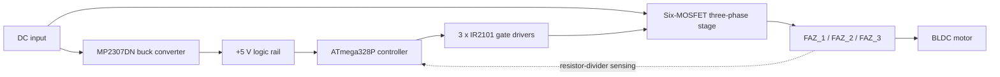
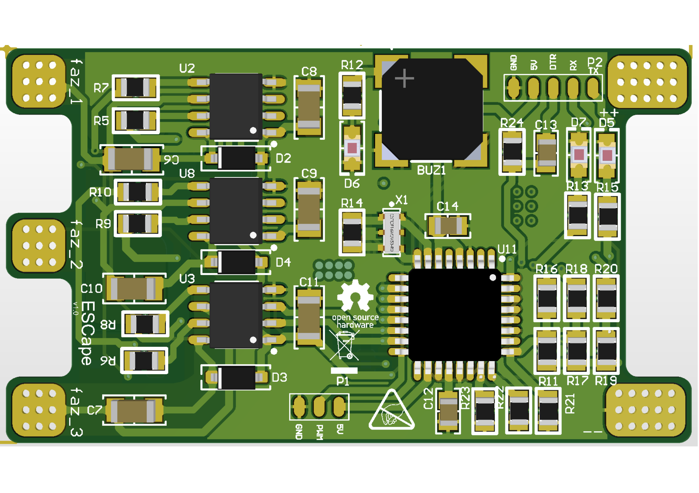
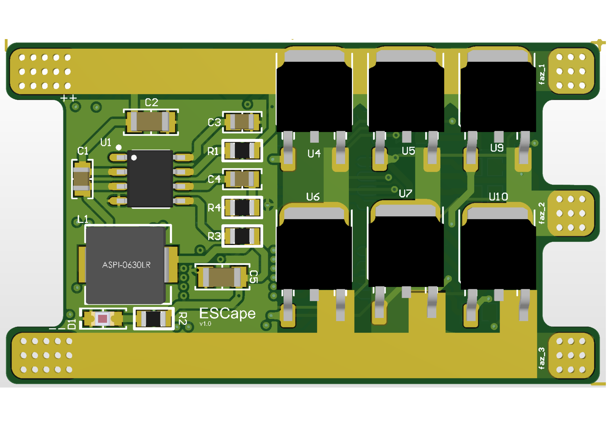
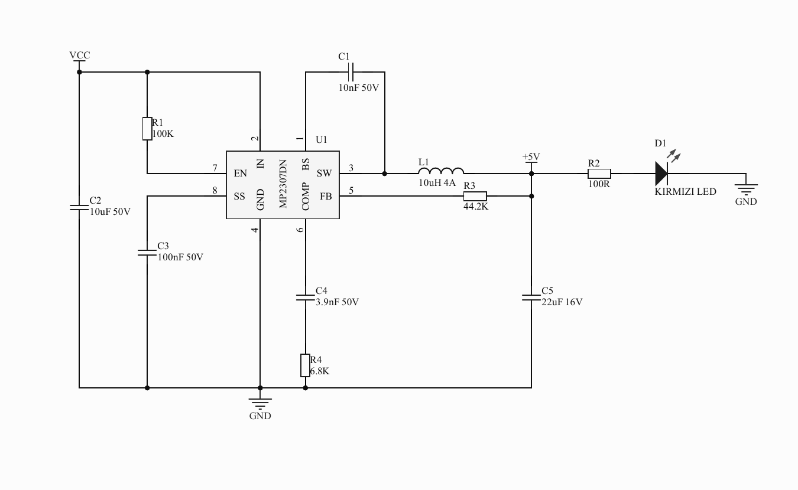
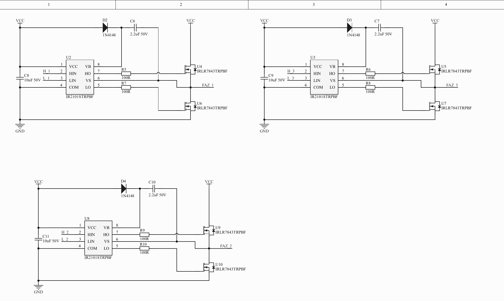
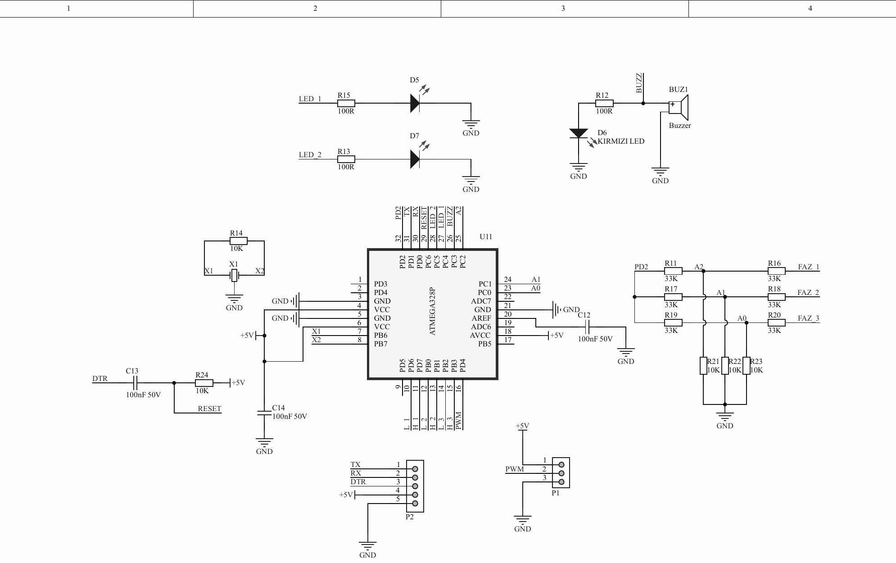

# Altium Designer | Four-Layer BLDC ESC PCB

Altium Designer project for a three-phase brushless DC motor controller (ESC). The design brings together a multi-sheet schematic, custom component libraries, and a routed PCB.

Altium Designer ile tasarlanmış üç fazlı BLDC motor sürücüsü (ESC) kartı. Proje; çok sayfalı şematik, bileşen kütüphaneleri ve PCB yerleşimini bir araya getiriyor.

**PCB stack / Katman yapısı:** 4 bakır katman — Top, Mid-Layer 1, Mid-Layer 2, Bottom (üst, iki iç katman ve alt).

## Design overview

The hardware is organized into three schematic sheets:

- **Power:** MP2307DN buck converter generating the +5 V logic rail.
- **MCU:** ATmega328P controller, UART/programming header, PWM interface, phase-voltage sensing, status LEDs, and buzzer.
- **Driver:** Three IR2101 half-bridge gate drivers controlling six IRL7843 MOSFETs, forming the three-phase switching stage.

The MCU reads the three phase sense signals through resistor dividers. Firmware is not included; this repository focuses on the hardware design.

## PCB views

The Altium source files are included for inspection and editing. These renders provide a quick visual review on GitHub.

## Schematics

Power sheet

Driver sheet

MCU sheet

## Project files

| File | Purpose |
| --- | --- |
| `ESCapeBoard.PrjPcb` | Altium project |
| `ESCapeBoard.PcbDoc` | PCB layout |
| `Power.SchDoc` | Power regulation schematic |
| `MCU.SchDoc` | Controller and sensing schematic |
| `Driver.SchDoc` | Gate driver and MOSFET schematic |
| `PROJE.PcbLib` | PCB footprint library |
| `PROJE.SchLib` | Schematic symbol library |

Open `ESCapeBoard.PrjPcb` in Altium Designer to browse the editable project. The PNG previews are included for quick review without Altium.

## Validation note

The saved DRC results include silkscreen-clearance items for review. Run a fresh DRC and verify electrical and thermal performance before fabrication; no hardware test results are included here.
